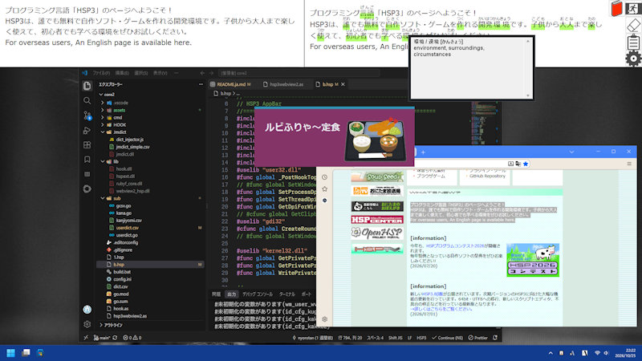
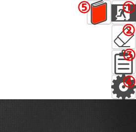
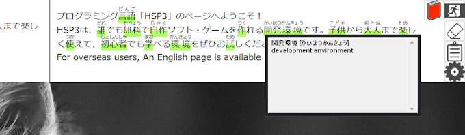
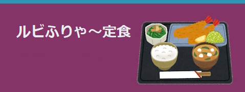

🌐 **English** | [日本語](README.ja.md)

# Ruby Furya Teishoku


- A Windows app that displays copied Japanese text with ruby (furigana).
- Copy or cut text from a webpage or text document to display it with ruby.
- The app's bar is displayed along the edge of the desktop, like a taskbar.
- Place the bar along any edge of the screen and show or hide it as needed.
- Includes a tagged-copy feature useful for writing HTML, Aozora Bunko, and other formats.
- Hover over a word in the bar to see its entry in the Japanese-English dictionary.
- The core dictionaries are built in, so the app works offline.

## Getting Started
1. Run `定食_main.exe`. The app stays in the system tray and displays a bar at the top of the screen.
2. Copy the text you want to add ruby to from any app you normally use.
3. The copied text appears in the bar with ruby.
4. Hover over a word in the displayed text to see a basic Japanese-English dictionary entry.
5. When you don't need the bar, hide it using one of the methods below.

## Showing and Hiding the Bar
Use any of the following methods to toggle the bar:

### Mouse
- Click the mouse's middle button (scroll wheel).

### Keyboard
- Hold the `Home` key and press `Space`.

### Other options
- Click the bar's toggle button.
- Right-click the system tray icon and select **Show** or **Hide**.

When the bar is hidden, the app also pauses clipboard monitoring. Monitoring resumes when you show the bar again.

## Bar Buttons


The bar has the following buttons:

1. **Toggle visibility** — Show or hide the bar.
2. **Clear** — Clear the currently displayed text.
3. **Copy** — Copy the text with ruby to the clipboard, inserting the tags configured in Settings.
4. **Settings** — Configure the tag format used when copying text with ruby.
5. **Dictionary** — Enable or disable the popup dictionary. The icon is red when the dictionary is enabled.

## Popup Japanese-English Dictionary



When the dictionary is enabled, hover over a word in the text displayed in the bar. After a short delay, its meaning appears in a popup. The popup closes shortly after you move the pointer away from the word.

To temporarily disable the dictionary, click the dictionary button on the bar. Click it again to enable the dictionary.

## Changing the Bar Position
Right-click the system tray icon and select **Top**, **Left**, **Right**, or **Bottom**. The bar appears along the selected edge of the screen.

## Ruby Settings
Click the Settings button on the bar to open the settings window. You can change the tags that wrap ruby text and the separator between the ruby and the base text. Review the example in the preview and click **Save**. Changes take effect after saving.

Click **Cancel** to discard your changes.

## User Dictionary
Use `dict.csv` to define ruby for individual words. Place the file in the same folder as the executable.

The file must be in CSV format, with each line containing these fields in order:

```csv
Word, Tokenized word, Reading, Part of speech
```

The number of space-separated parts in **Tokenized word** must match the number of parts in **Reading**. If they do not match, the user dictionary cannot be loaded and initialization fails during conversion with error code `-3`. If the word is not split, do not split its reading either.

Example:
```csv
プロ生ちゃん,プロ 生 ちゃん,プロ ナマ チャン,人名
珠音ちゃん,珠音 ちゃん,タマネ チャン,人名
```

## Font Settings
Edit `config.ini` to configure the display font.

```ini
[font]
Fname=meiryo
Fsize=16
Fstyle=0
```

`Fstyle` accepts the following values:

```text
0: Regular
1: Bold
2: Italic
3: Bold and italic
```

## Exiting the App
Right-click the system tray icon and select **Exit**.

You can also exit by holding the `Home` key and pressing `Escape`.

## Web Component
The app uses Microsoft Edge WebView2, implemented with **[webview2_hsp.dll](https://github.com/nyorotan/webview2_hsp_dll/blob/main/README.ja.md)**.

This DLL is based on the `go-webview2` interface for using WebView2 from Go and is built with cgo.

## Notes
- Avoid using this app alongside other clipboard-enhancement software, as they may interfere with one another.
- The app reads text copied to the clipboard in order to process it.
- Copied text is processed by the app to add ruby. Review the result before pasting it elsewhere.
- Ruby readings are generated automatically and may be incorrect for proper nouns or depending on context.

## Acknowledgments

### Morphological Analysis
- This app uses the following component for morphological analysis. Many thanks to its author:
  - Kagome v2 by ikawaha

```text
github.com/ikawaha/kagome/v2
https://github.com/ikawaha/kagome/v2
```

### Dictionaries

- **UniDic** (morphological analysis)
  - National Institute for Japanese Language and Linguistics
- **JMdict** (Japanese dictionary)
  - Electronic Dictionary Research and Development Group (EDRDG)
- **Jōyō Kanji List** (Cabinet Notification No. 2 of 2010)
  - Ministry of Education, Culture, Sports, Science and Technology (MEXT)

## License

This project is released under the MIT License. You are free to use it for commercial or non-commercial purposes.

- **Copyright:** © 2026 nyorotan

## Version

- **Version:** v1.0.0
- **Author:** nyorotan


